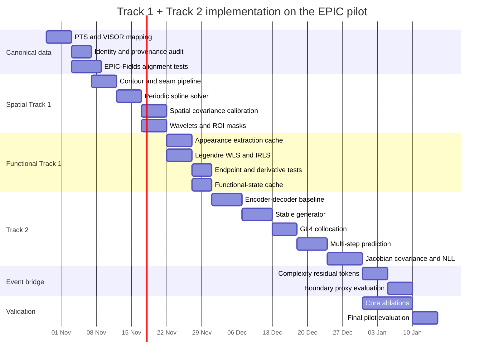

# Implementation Blueprint for Finalised Track 1 and Track 2 Training on EPIC-KITCHENS + VISOR + EPIC-Fields

## Executive summary

The best implementation strategy for the M4 Max is **not** to train the entire visual-to-dynamics architecture end-to-end from raw video. The architecture already gives us a much more computationally efficient decomposition:

\[
\boxed{
\text{raw video}
\rightarrow
\text{canonical observations}
\rightarrow
\underbrace{\text{deterministic Track 1 functional states}}_{\text{precompute}}
\rightarrow
\underbrace{\text{small Track 2 dynamical model}}_{\text{train repeatedly}}
}
\]

That separation is particularly appropriate for your two-hour pilot. VISOR provides manually labelled and interpolated hand/object masks plus hand–object relations; EPIC-KITCHENS supplies action intervals; EPIC-Fields adds reconstructed camera intrinsics, poses and sparse 3D scene geometry. The official VISOR release contains both manual masks and dense interpolations, and the official tooling explicitly provides frame/timestamp correspondences because EPIC source videos have differing frame rates. citeturn11academia25turn0search0turn0search2 EPIC-Fields stores OpenCV/COLMAP-style intrinsics and world-to-camera poses; critically, that is **camera geometry, not metric depth for dynamic hands and objects**. citeturn6search0turn11academia24

The architecture I recommend is therefore:

```text
                        OFFLINE / VERSIONED
                              │
Raw MP4 + VISOR + EPIC-Fields
              │
              ▼
      CanonicalObservation
  PTS / polygons / provenance /
   camera pose / track identity
              │
              ▼
     Per-frame spatial Track 1
 periodic B-spline → covariance
 → wavelet → soft ROI appearance
              │
              ▼
   1 s temporal Track 1 windows
          hop = 0.25 s
 weighted robust Legendre solve
 endpoint + velocity + acceleration
        + coefficient covariance
              │
              ▼
    FunctionalEntityState cache
                              │
                     TRAINABLE / FAST
                              │
                              ▼
      Pointwise dynamical state ξ(t)
        + Gauss-Legendre nodes
                              │
                              ▼
           Encoder gθ(ξ) → z
                              │
                              ▼
      Shared continuous generator
             A = (J-R)H
                              │
              ┌───────────────┴──────────────┐
              ▼                              ▼
       Collocation loss              K(Δ)=exp(ΔA)
       ż ≈ Az                         multi-step prediction
              │                              │
              └───────────────┬──────────────┘
                              ▼
                  probabilistic Track 2
                reconstruction + NLL
                              │
                              ▼
                  DynamicalEntityState
```

This keeps the finalised Track 1 decisions intact: periodic cubic B-splines, temporal seam consistency, normal-direction uncertainty propagation, translation/shape separation, conservative inner-core appearance masking, and spatial-before-temporal execution. fileciteturn0file3 It also preserves the strongest conclusion from the earlier temporal analysis: keep **one canonical Legendre coordinate system** and solve the small weighted system rather than creating a different orthogonal basis for each window. fileciteturn0file6

For the first implementation I recommend the following baseline configuration:

| Component | Baseline |
|---|---:|
| Spatial control points | \(M=16\) |
| Spatial spline | periodic cubic, degree \(3\) |
| Contour evaluation cache | \(Q=64\) boundary samples |
| Spatial robust loss | Huber |
| Wavelet | one-level periodised `db2` |
| Appearance embedding | 128-D, frozen MobileNetV3-Small backbone |
| Track 1 temporal basis | Legendre degree \(3\), four coefficients |
| Track 1 window | \(1.0\) s |
| Track 1 hop | \(0.25\) s |
| Temporal robust solver | Huber IRLS + Cholesky, QR fallback |
| Collocation | four-point Gauss–Legendre |
| Track 2 physical state | derivative-aware, about \(68\) dims for \(M=16\) |
| Koopman latent | \(d_z=32\) |
| Generator | shared \(A=(J-R)H\) |
| One training sequence | 12–16 overlapping functional states |
| Prediction horizons | \(0.25,0.5,1,2\) s |
| Main device | MPS, `float32` |
| Exact geometry / calibration | CPU/SciPy where useful |

PyTorch's current MPS backend runs tensors and modules through Metal on Apple silicon, while `float64` tensors are not supported on MPS; genuine double-precision calculations therefore need to remain on CPU. PyTorch also exposes CPU fallback for unsupported MPS operations. citeturn13search1turn13search0 That makes a hybrid CPU/MPS pipeline particularly sensible here: geometric preprocessing is tiny linear algebra and benefits from numerical robustness, while appearance extraction and neural training are much better candidates for the GPU.

The two-hour-two-minute pilot corresponds to about **29,277 one-second/0.25-second windows for one entity that existed continuously throughout the entire recording**; the actual entity-window count will be higher because multiple hands/objects coexist, but lower for intermittent tracks. This is small enough that the entire Track 1 functional-state cache should be measured in gigabytes rather than hundreds of gigabytes, allowing many Track 2 experiments locally without repeatedly decoding video.

## Canonical dataset and observation contract

The most consequential preprocessing step is not spline fitting. It is making **time, identity, geometry and annotation provenance unambiguous** before any mathematics touches them.

VISOR's sparse annotations contain per-image polygons, entity names/classes, `exhaustive` flags, hand-contact fields and subsequence identifiers; dense annotations are interpolated between ground-truth endpoints and distinguish `type=0` interpolations from `type=1` retained endpoints. The official VISOR tooling also supplies `frame_mapping.json` and frame-to-timestamp information precisely because VISOR and the original EPIC extraction need not share frame numbering directly. citeturn0search0turn0search2 Your local dataset already preserves this source distinction, which is exactly what the mathematical weighting scheme needs.

EPIC action annotations should remain a separate label layer. They contain action start/stop timestamps and verb/noun labels and are useful later for event-boundary evaluation, but they must not determine the physical geometry. fileciteturn0file0

**Build one canonical timestamp table before doing anything else.**

For each MP4:

\[
\mathcal T_v
=
\{
(f,\operatorname{PTS}_f,t_f)
\}_{f=0}^{F-1}.
\]

Extract it with PyAV/FFmpeg from the native MP4. Use

\[
t_f =
\operatorname{PTS}_f \times \text{time\_base}
\]

rather than

\[
t_f=f/\mathrm{FPS}.
\]

Then construct:

```text
VISOR frame name
      │
      ├── frame_mapping.json
      │
      ├── official frames_to_timestamps mapping
      │
      ▼
EPIC/source-frame correspondence
      │
      ▼
nearest verified native MP4 PTS
      │
      ▼
canonical timestamp_us
```

The official VISOR frame-extraction code specifically handles frame/timestamp correspondence and includes corrections relevant to dense interpolation data; run those official correction/validation steps before building your canonical table rather than assuming all archived interpolation files are already equivalent. citeturn0search2

A robust acceptance check is

\[
|t_{\text{official}}-t_{\text{native PTS}}|
<
\frac{1}{2}\operatorname{median}_f(t_{f+1}-t_f)
\]

for mappings where both are available. Fail the preprocessing job rather than silently picking a frame when this condition is violated.

**Mask provenance must remain explicit.**

Use an enum such as:

```python
MaskSource = Literal[
    "manual",
    "dense_endpoint",
    "interpolated",
]
```

Initial *reliability priors* can be:

\[
q_{\text{prov}}=
\begin{cases}
1.00,&\text{manual},\\
0.90,&\text{dense endpoint},\\
0.60,&\text{interpolated}.
\end{cases}
\]

These values are deliberately called priors, **not probabilities**. VISOR states that the released interpolations were filtered for quality, but that does not make them calibrated per-pixel measurement uncertainties. citeturn0search0turn11academia25 The values should later be calibrated empirically by asking how well interpolated contours agree with held-out manual contours.

`exhaustive="n"` must also not be interpreted as “there are no other objects of this class”; VISOR explicitly uses the field to indicate whether all class instances have been segmented. Similarly, a hand marked `none-of-the-above` is evidence that it contacts something outside the segmented set, not evidence of “no contact”. citeturn0search0

**Track identities require an explicit policy.**

Do not assume a raw mask `id` is a globally persistent physical identity. Build:

\[
\texttt{entity\_track\_id}
=
(\texttt{video},
 \texttt{subsequence},
 \texttt{entity\_linkage})
\]

from the VISOR subsequence, dense interpolation linkage, entity name/class and hand side. VISOR subsequences are specifically used to create sequences with consistent entity sets for its video-object-segmentation benchmark. citeturn0search0turn0search3

Recommended rules:

| Situation | Canonical behaviour |
|---|---|
| Same interpolation sequence | retain identity |
| Hand side explicitly known | left/right is part of identity |
| Short missing interval \(<0.35\) s | preserve identity but store no fabricated observations |
| Long gap | split into a new track segment unless source linkage proves continuity |
| VISOR subsequence changes | default to new segment |
| Ambiguous duplicate noun | split rather than guessing |
| Object splits physically | create lineage metadata rather than forcing one contour |

That last point matters in kitchens: peeling, cutting and separating objects are common in VISOR's design motivation. citeturn11academia25

**Canonical camera record.**

EPIC-Fields uses an OpenCV/COLMAP camera model:

\[
K=
\begin{bmatrix}
f_x&0&c_x\\
0&f_y&c_y\\
0&0&1
\end{bmatrix}
\]

with distortion \((k_1,k_2,p_1,p_2)\), and its image records contain a quaternion and translation giving a **world-to-camera** transformation. citeturn6search0turn0file1

If EPIC-Fields' reconstruction image size is \((W_F,H_F)\) but the native video size is \((W_V,H_V)\), an uncropped pure resize implies

\[
K_V=
\begin{bmatrix}
W_V/W_F&0&0\\
0&H_V/H_F&0\\
0&0&1
\end{bmatrix}K_F.
\]

Do not apply this blindly if aspect ratio, cropping or extraction differs; validate by projecting a handful of EPIC-Fields points onto decoded video frames. EPIC-Fields' released point cloud and camera poses provide exactly the ingredients for that check. citeturn6search0turn11academia24

Invert the released world-to-camera pose as

\[
R_{cw}=R_{wc}^{\top},
\qquad
t_{cw}=-R_{wc}^{\top}t_{wc}.
\]

For the initial pipeline, **do not claim metric 3D coordinates for hands/objects**. EPIC-Fields reconstructs the camera and static scene; it does not directly supply reliable metric per-pixel depth for each moving hand/object. citeturn11academia24turn6search1

Use three geometry validity modes:

```python
CanonicalMode = Literal[
    "intrinsic_normalised_2d",
    "world_bearing",
    "metric_3d",
]
```

The pilot should use the first two. Metric 3D stays disabled unless a later depth module passes validation.

For the camera-normalised baseline,

\[
x_n=\frac{u-c_x}{f_x},
\qquad
y_n=\frac{v-c_y}{f_y},
\]

after OpenCV distortion correction.

For a camera-rotation-compensated direction,

\[
b_c=
\frac{(x_n,y_n,1)^\top}
{\|(x_n,y_n,1)\|},
\qquad
b_w=R_{cw}b_c.
\]

This is a **world bearing**, not a world position.

For the contour, separate translation and apparent scale:

\[
\bar P_f=P_f-\mathbf1p_f^\top,
\]

\[
s_f=
\sqrt{\frac{A_f}{\pi}},
\qquad
P_f^{shape}=
\frac{\bar P_f}{s_f+\epsilon}.
\]

Retain \(\log s_f\) as its own channel. This prevents gross perspective size changes from contaminating shape deformation while not throwing the apparent scale information away.

The canonical observation schema should therefore look like:

```python
@dataclass
class CanonicalObservation:
    video_id: str
    participant_id: str
    entity_track_id: str

    pts_us: int
    visor_frame_name: str
    source_frame_index: int

    mask_source: int
    provenance_weight: float
    exhaustive: int
    contact_annotation: int

    # Variable-length source geometry
    contour_xy_native: Tensor       # [N, 2]
    ring_offsets: Tensor            # supports multi-ring masks
    bbox_xyxy: Tensor               # [4]
    centroid_native: Tensor         # [2]
    mask_area: float

    # Camera record
    intrinsic_native: Tensor        # [3, 3]
    distortion: Tensor              # [4]
    world_to_camera: Tensor         # [4, 4]
    camera_valid: bool
    camera_quality: float

    # Canonical geometry
    centroid_normalised: Tensor     # [2]
    world_bearing: Tensor           # [3]
    apparent_log_scale: float
    canonical_mode: int

    quality_flags: int
```

Store scalar/index metadata in **Parquet** and variable/fixed tensors in per-video tensor shards. Never duplicate native RGB frames; decode them lazily from the compressed MP4.

A sensible on-disk structure is:

```text
derived/
├── canonical_v1/
│   ├── index.parquet
│   ├── Pxx_xxx.pt
│   └── manifest.json
├── track1_spatial_v1/
│   ├── index.parquet
│   └── Pxx_xxx.pt
├── track1_functional_v1/
│   ├── index.parquet
│   └── Pxx_xxx.pt
└── training_v1/
    ├── train_index.parquet
    ├── validation_index.parquet
    └── test_index.parquet
```

Every manifest should contain source hashes, preprocessing configuration hash, git commit, PyTorch/SciPy/PyWavelets versions and mathematical schema version. This gives you reproducibility even when bitwise GPU determinism across software releases is unavailable.

## Spatial Track 1 implementation

The finalised Track 1 specifies a per-frame periodic cubic spline fit, propagated normal uncertainty, subject-relative shape representation, periodic wavelets and separate inner-core/outer-halo masks. fileciteturn0file3 The earlier ribbon design also correctly established that a compact spline should be the persistent representation while the ROI mask is rasterised temporarily; this avoids storing dense SDFs. fileciteturn0file5

There are, however, three implementation refinements worth enforcing: spline fitting does **not** automatically prevent self-intersection; the inverse Gram matrix is only a statistical covariance under an explicit noise/prior interpretation; and centre-to-boundary radial interior sampling must not be used because deeply concave contours need not be star-shaped.

**Contour extraction and correspondence.**

From each VISOR polygon:

1. Rasterise at the appropriate source/native coordinate system.
2. Validate polygon winding and self-intersections.
3. Extract external contour rings and holes.
4. Keep component/ring metadata rather than flattening every mask into one loop.
5. For the initial Track 1 state, choose the dominant external ring and flag multi-component cases.
6. Resample the selected loop uniformly by arc length to \(N_s=64\) or \(128\) points.

Set loop orientation consistently, e.g. counter-clockwise.

The seam needs more care than merely picking “the top point”. The first frame of a track can use the finalised deterministic \(+\pi/2\) reference rule. fileciteturn0file3 Subsequent frames should select the cyclic shift that minimises the discrepancy with the previous canonical contour:

\[
r_f^\star
=
\arg\min_{r\in\{0,\ldots,N_s-1\}}
\sum_j
\omega_j
\left\|
\tilde y_{f,(j+r)\bmod N_s}
-
\tilde y_{f-1,j}
\right\|^2 .
\]

The shift affects only indexing; it must not rotate or deform the actual observation. This makes temporal control-point correspondence substantially more robust to small contour extraction changes while preserving a deterministic bootstrap seam.

**Periodic cubic B-spline fit.**

Let

\[
Y_f\in\mathbb R^{N_s\times2}
\]

be the aligned boundary points and use \(M=16\) control points.

The periodic cubic spline is

\[
\gamma_f(u)
=
\sum_{m=0}^{M-1}
B_m^{(3)}(u)P_{f,m}.
\]

Cubic B-spline basis functions have compact support; SciPy's B-spline tools expose periodic evaluation and sparse design matrices, which is useful for creating and verifying the frozen basis matrices. citeturn3search0turn3search10

Build

\[
\Phi_s[j,m]
=
B_m^{(3)}(u_j).
\]

Let \(D_2\) be a circular second-difference matrix:

\[
(D_2P)_m
=
P_{m-1}-2P_m+P_{m+1},
\]

with indices modulo \(M\).

Solve

\[
\boxed{
\hat P
=
\arg\min_P
\left\|
W_s^{1/2}(\Phi_sP-Y)
\right\|_F^2
+
\lambda_s\|D_2P\|_F^2.
}
\]

The normal equations are

\[
G_s
=
\Phi_s^\top W_s\Phi_s
+
\lambda_sD_2^\top D_2
+
\lambda_0I,
\]

\[
G_s\hat P
=
\Phi_s^\top W_sY.
\]

Do **not** form \(G_s^{-1}\Phi_s^\top W_sY\) explicitly.

Use:

\[
\hat P=\operatorname{solve}(G_s,B_s).
\]

For Track 1 preprocessing this does not need to run on MPS. CPU/SciPy or CPU PyTorch is perfectly reasonable and lets you use higher precision for calibration. On MPS, PyTorch's linear-algebra stack includes Cholesky, QR and linear solves, but MPS itself does not support double precision. citeturn2search1turn13search1

**Robust spatial IRLS.**

Define standardised residuals

\[
r_j
=
\frac{
\|\Phi_s[j,:]P-Y_j\|_2
}{
\sigma_j+\sigma_{\rm floor}
}.
\]

Use Huber weights

\[
\omega_H(r)=
\begin{cases}
1,&|r|\le\delta,\\
\delta/|r|,&|r|>\delta .
\end{cases}
\]

Huber's original robust-estimation formulation was designed for estimators that remain efficient under approximately Gaussian data while reducing sensitivity to gross contamination. citeturn12search1

Then

\[
w_j
=
q_{\rm provenance,j}
q_{\rm geometry,j}
\omega_H(r_j).
\]

Three IRLS iterations are a good baseline; convergence can terminate early when

\[
\frac{\|P^{(k)}-P^{(k-1)}\|_F}
{\|P^{(k-1)}\|_F+\epsilon}
<10^{-4}.
\]

Recommended initial parameters:

```yaml
track1:
  spatial:
    control_points: 16
    degree: 3
    resampled_boundary_points: 64
    lambda_curvature: 1.0e-3
    lambda_ridge: 1.0e-6
    huber_delta: 1.5
    irls_iterations: 3
```

Scale \(\lambda_s\) relative to the data term rather than treating \(10^{-3}\) as universally meaningful:

\[
\lambda_s^{eff}
=
\lambda_s
\frac{\operatorname{tr}(\Phi^\top W\Phi)}
{\operatorname{tr}(D_2^\top D_2)+\epsilon}.
\]

**Spatial covariance.**

Under

\[
Y=\Phi_sP+\varepsilon,
\qquad
\varepsilon\sim\mathcal N(0,W^{-1}),
\]

and a Gaussian smoothness prior with precision

\[
\Lambda_s=\lambda_sD_2^\top D_2+\lambda_0I,
\]

the posterior coefficient covariance for one coordinate is

\[
\boxed{
\Sigma_P
=
(\Phi_s^\top W\Phi_s+\Lambda_s)^{-1}.
}
\]

If the weights are only **relative reliability weights**, not absolute inverse variances, then the correctly scaled quantity is instead approximately

\[
\Sigma_P
=
\hat\sigma^2G_s^{-1},
\]

with \(\hat\sigma^2\) calibrated from residuals. Under IRLS this Gaussian interpretation is also approximate because the final weights depend on the data.

That distinction is important: \(G_s^{-1}\) is not automatically “physical uncertainty”.

Use the manually annotated VISOR frames to fit a calibration multiplier \(\kappa_{\rm cov}\) so that, for example, nominal \(95\%\) contour ribbons achieve approximately \(95\%\) empirical boundary coverage. Manual and interpolated masks should be evaluated separately because their provenance differs. citeturn0search0turn11academia25

For any \(u\), let

\[
b(u)=
[B_0(u),\ldots,B_{M-1}(u)]^\top.
\]

Then for the simple isotropic coordinate model,

\[
\Sigma_\gamma(u)
=
\left[b(u)^\top\Sigma_Pb(u)\right]I_2.
\]

For a full block model, use the corresponding \(2M\times2M\) control-point covariance.

The tangent is

\[
t(u)=\gamma'(u),
\]

and, for CCW orientation, a unit normal can be constructed as

\[
n(u)
=
\frac{(t_y,-t_x)}
{\|t\|+\epsilon}
\]

with its sign checked against the polygon interior.

The normal uncertainty is

\[
\boxed{
\sigma_n^2(u)
=
n(u)^\top
\Sigma_\gamma(u)
n(u).
}
\]

That is the quantity to use for the ribbon, not \(\operatorname{diag}(G_s^{-1})\) directly.

**Periodic wavelet decomposition.**

Work on centred, scale-canonical control points:

\[
\tilde P_f
=
\frac{P_f-\mathbf1p_f^\top}
{s_f+\epsilon}.
\]

Use a fixed one-level periodised transform:

\[
Z_f
=
W_{\rm wav}\tilde P_f.
\]

For \(M=16\),

\[
Z_f=
\begin{bmatrix}
A_f\\
D_f
\end{bmatrix},
\qquad
A_f,D_f\in\mathbb R^{8\times2}.
\]

PyWavelets supports periodisation boundary handling and one-level approximation/detail decomposition; its periodisation mode also produces the smallest coefficient count for the transform. citeturn4search1turn4search7

I recommend `db2` initially rather than implementing a bespoke spline-wavelet package. Generate the fixed \(16\times16\) transform matrix once by applying the periodised DWT to the identity matrix, store it with the model configuration, then use ordinary matrix multiplication in PyTorch.

Covariance propagates exactly through this linear transformation:

\[
\boxed{
\Sigma_Z
=
W_{\rm wav}
\Sigma_{\tilde P}
W_{\rm wav}^\top .
}
\]

A standard decimated DWT is shift-sensitive; our seam-alignment stage is therefore not optional. A stationary wavelet transform is an excellent ablation later if residual seam jitter remains problematic.

**Soft ROI rasterisation and appearance pooling.**

Do not use the centre-radial interior coordinate proposed in an earlier exploratory design; concave masks can intersect a radial ray multiple times. The persistent representation remains the spline, while feature masking is generated from an ROI-local polyline/SDF. That follows the useful part of the earlier ribbon proposal while avoiding its star-shape assumption. fileciteturn0file5

Evaluate the spline at \(Q=64\) points and transform them into feature-map coordinates. For each ROI cell \(x\), compute a signed distance \(d(x)\), where

\[
d(x)<0
\]

means inside.

Interpolate the local normal standard deviation \(\sigma_n(x)\) from the nearest segment.

Define the conservative core as

\[
\boxed{
m_{\rm core}(x)
=
\sigma\left(
-\frac{d(x)+\kappa_{\rm core}\sigma_n(x)}
{\tau_{\rm mask}}
\right)
}
\]

and the uncertainty halo as

\[
m_{\rm halo}(x)
=
\sigma\left(
-\frac{d(x)-\kappa_{\rm halo}\sigma_n(x)}
{\tau_{\rm mask}}
\right).
\]

Use, initially,

\[
\kappa_{\rm core}=1,
\qquad
\kappa_{\rm halo}=2.
\]

Only `m_core` is used for semantic appearance pooling:

\[
\boxed{
a_f=
\frac{
\sum_xm_{\rm core}(x)F_f(x)
}{
\sum_xm_{\rm core}(x)+\epsilon
}.
}
\]

Store the halo only for future Track 3 contact reasoning.

A frozen MobileNetV3-Small is a sensible M4 baseline: TorchVision provides pretrained weights, and the official implementation is about 2.5 million parameters and 0.06 GFLOPS at its standard classification setting. citeturn11search0 Do not retain full feature maps. Decode one RGB frame, obtain its feature map once, pool all entity masks in that frame, store a projected 128-dimensional embedding, then discard the map.

Representative PyTorch-style preprocessing:

```python
def fit_periodic_spline(
    phi: torch.Tensor,       # [N, M]
    points: torch.Tensor,    # [N, 2]
    base_weights: torch.Tensor,
    d2: torch.Tensor,        # [M, M]
    lambda_curv: float,
    lambda_ridge: float,
    huber_delta: float = 1.5,
    irls_steps: int = 3,
):
    dtype = points.dtype
    m = phi.shape[-1]
    eye = torch.eye(m, dtype=dtype, device=points.device)

    w = base_weights.clamp_min(0)

    for _ in range(irls_steps):
        gram = phi.T @ (w[:, None] * phi)
        reg = lambda_curv * (d2.T @ d2) + lambda_ridge * eye
        g = gram + reg

        rhs = phi.T @ (w[:, None] * points)

        # SPD by construction when regularised.
        chol = torch.linalg.cholesky(g)
        p = torch.cholesky_solve(rhs, chol)

        residual = torch.linalg.vector_norm(phi @ p - points, dim=-1)
        robust = torch.where(
            residual <= huber_delta,
            torch.ones_like(residual),
            huber_delta / residual.clamp_min(1e-8),
        )
        w = base_weights * robust

    # Solve against I; don't use torch.inverse in production.
    sigma_p = torch.cholesky_solve(eye, chol)

    return p, sigma_p, w
```

For preprocessing, run the above on CPU, preferably in `float64`, and cast derived tensors to `float32` before Track 2. MPS does not support float64 tensors. citeturn13search1

**Planning compute envelope for the spatial path.** These are engineering budgets to benchmark on your machine, not published M4 Max measurements.

| Operation | Size | Mathematical cost | Practical target |
|---|---:|---:|---:|
| contour extraction | ROI pixels | \(O(\text{ROI})\) | \(1{-}5\) ms/entity-frame CPU |
| spline design/evaluation | \(64\times16\) | tiny | \(<0.1\) ms after batching |
| \(16\times16\) Cholesky | \(M=16\) | \(O(M^3)\) | \(<0.1\) ms kernel time |
| wavelet | \(16\times16\times2\) | 512 MACs | negligible |
| 64-segment ROI SDF | e.g. \(16\times16\) feature cells | \(\sim16\)k segment tests | \(0.05{-}1\) ms batched |
| frozen CNN | per decoded frame | dominant | benchmark first; likely dominates preprocessing |

The Python loop and video decoding overhead can exceed the tiny spline arithmetic. Batch by video/frame and move loops out of Python wherever possible.

## Temporal Track 1 and functional collocation

The temporal layer should consume the **canonical frame-level state**, not raw pixel coordinates.

For \(M=16\), a practical frame state is

\[
h_f=
\begin{bmatrix}
p_f^{can}\\
\operatorname{vec}(Z_f)\\
\log s_f
\end{bmatrix}.
\]

For a 2-D canonical position this gives

\[
D_h=2+32+1=35.
\]

Appearance remains separate rather than forcing every appearance channel to obey polynomial motion dynamics.

**Window indexing.**

For output time \(T_k\),

\[
T_k=T_0+0.25k,
\]

use

\[
I_k=[T_k-1,T_k].
\]

Do not resample to an artificial fixed FPS. Select all valid observations by PTS.

Normalise each timestamp:

\[
\boxed{
\tau_{kf}
=
2\frac{t_f-(T_k-1)}{1\text{ s}}-1
\in[-1,1].
}
\]

The degree-three Legendre basis is

\[
P_0(\tau)=1,
\]

\[
P_1(\tau)=\tau,
\]

\[
P_2(\tau)=\frac12(3\tau^2-1),
\]

\[
P_3(\tau)=\frac12(5\tau^3-3\tau^2\cdot0-3\tau)
=
\frac12(5\tau^3-3\tau).
\]

Thus

\[
\Phi_t=
\begin{bmatrix}
P_0(\tau_1)&P_1(\tau_1)&P_2(\tau_1)&P_3(\tau_1)\\
\vdots&\vdots&\vdots&\vdots
\end{bmatrix}.
\]

Legendre polynomials are orthogonal under their continuous uniform inner product, but discrete, irregularly sampled or confidence-weighted observations do not in general retain that exact orthogonality. The correct implementation is therefore the weighted solve already selected for Track 1 rather than a frozen projection formula. citeturn3search12 fileciteturn0file6

**Time-gap quadrature.**

For irregular PTS, define coverage weights

\[
q_i^{time}
\approx
\frac{\tau_{i+1}-\tau_{i-1}}{2}
\]

with one-sided endpoint variants.

This prevents a cluster of closely spaced frames from being counted as if it covered more physical time than a sparse portion of the window.

For state feature \(d\),

\[
w_{i,d}
=
q_i^{time}
\frac{
q_i^{obs}q_i^{prov}
}{
\sigma_{i,d}^{2}+\sigma_{\rm floor,d}^2
}
\omega_H(r_{i,d}).
\]

This is the point where the spatial covariance actually enters the temporal Seesaw.

**Weighted robust temporal solve.**

For each feature \(d\),

\[
C_d\in\mathbb R^4
\]

solves

\[
\boxed{
\min_{C_d}
\sum_i
w_{i,d}
\left(h_{i,d}-\phi_i^\top C_d\right)^2
+
C_d^\top\Lambda_tC_d .
}
\]

Use a higher-mode prior:

\[
\Lambda_t
=
\lambda_t
\operatorname{diag}(0,1,4,9)
+
\lambda_0I.
\]

Then

\[
G_d
=
\Phi^\top W_d\Phi+\Lambda_t,
\]

\[
\boxed{
\hat C_d
=
G_d^{-1}
\Phi^\top W_dh_d
}
\]

implemented through Cholesky/QR rather than an inverse.

For the Gaussian precision interpretation,

\[
\boxed{
\Sigma_{C,d}
=
G_d^{-1}.
}
\]

Again, relative weights require calibration by a residual noise scale.

For the first implementation, preserve one \(4\times4\) covariance per state feature. That is only

\[
35\times16=560
\]

floats per window before symmetric packing.

**Do not reduce the coefficients to “position, velocity, acceleration, jerk” labels.** Legendre coefficients themselves are not derivatives. Evaluate derivatives analytically.

At the endpoint \(\tau=1\),

\[
\ell_0=
[1,1,1,1].
\]

Therefore,

\[
\boxed{
h(T_k)=
\ell_0C.
}
\]

Since

\[
\frac{d\tau}{dt}=\frac{2}{T_w}
\]

with \(T_w=1\) s, and

\[
[P_0'(1),P_1'(1),P_2'(1),P_3'(1)]
=
[0,1,3,6],
\]

we have

\[
\boxed{
\dot h(T_k)=
\frac{2}{T_w}
[0,1,3,6]C.
}
\]

Likewise,

\[
[P_0''(1),P_1''(1),P_2''(1),P_3''(1)]
=
[0,0,3,15],
\]

so

\[
\boxed{
\ddot h(T_k)=
\frac{4}{T_w^2}
[0,0,3,15]C.
}
\]

The covariance maps linearly:

\[
\operatorname{Var}[h_d(T)]
=
\ell_0\Sigma_{C,d}\ell_0^\top,
\]

\[
\operatorname{Var}[\dot h_d(T)]
=
\ell_1\Sigma_{C,d}\ell_1^\top,
\]

and the cross-covariance is

\[
\operatorname{Cov}(h_d,\dot h_d)
=
\ell_0\Sigma_{C,d}\ell_1^\top.
\]

This cross-term becomes useful when we build Track 2's derivative-aware Markov state.

**Window validity.**

I would reject a functional state from direct Track 2 supervision when any of the following holds:

\[
N_{\rm eff}
=
\frac{(\sum_iw_i)^2}{\sum_iw_i^2}
<6,
\]

or high-quality observations span less than \(0.6\) s of the one-second window, or the largest unsupported temporal gap exceeds roughly \(0.35\) s.

Do not delete the window; retain it with `valid=False`, because missingness itself is useful information later.

The resulting contract should be:

```python
@dataclass
class FunctionalEntityState:
    video_id: str
    entity_track_id: str

    window_start_us: int
    window_end_us: int
    window_seconds: float      # 1.0
    hop_seconds: float         # 0.25

    canonical_mode: int

    # Standard Legendre coordinates.
    coefficients: Tensor       # [4, D_h]
    coefficient_cov: Tensor    # [D_h, 4, 4]

    endpoint: Tensor           # [D_h]
    endpoint_velocity: Tensor  # [D_h]
    endpoint_accel: Tensor     # [D_h]

    endpoint_cov: Tensor       # block/diag representation
    appearance: Tensor         # [128]

    effective_samples: float
    max_gap_seconds: float
    weighted_fit_rmse: float
    condition_score: float

    manual_fraction: float
    interpolation_fraction: float
    valid: bool
```

**Four-point Gauss–Legendre collocation.**

This is where the polynomial representation becomes more than compression.

For four-point Gauss–Legendre quadrature on \([-1,1]\),

\[
\tau_q\in
\{-0.8611363116,-0.3399810436,
0.3399810436,0.8611363116\},
\]

with weights

\[
\omega_q\in
\{0.3478548451,0.6521451549,
0.6521451549,0.3478548451\}.
\]

An \(n\)-point Gauss–Legendre rule integrates polynomials through degree \(2n-1\) exactly; therefore the four-point rule is exact through degree seven. citeturn5search0

At each node,

\[
h_q=\phi(\tau_q)^\top C,
\]

\[
\dot h_q
=
\frac2{T_w}
\phi'(\tau_q)^\top C,
\]

\[
\ddot h_q
=
\frac4{T_w^2}
\phi''(\tau_q)^\top C.
\]

This gives four continuous physical-time supervision points from the one-second functional fit, without pretending they are four new independent measurements.

For Track 2, construct the dynamical state

\[
\xi_q=
\begin{bmatrix}
v_{\rm translation,q}\\
z_{\rm shape,q}\\
\dot z_{\rm shape,q}\\
\log s_q\\
\dot{\log s}_q
\end{bmatrix},
\]

and

\[
\dot\xi_q=
\begin{bmatrix}
a_{\rm translation,q}\\
\dot z_{\rm shape,q}\\
\ddot z_{\rm shape,q}\\
\dot{\log s}_q\\
\ddot{\log s}_q
\end{bmatrix}.
\]

For \(M=16\), two-dimensional translation and 32 shape coordinates,

\[
D_\xi
=
2+32+32+1+1
=
68.
\]

I recommend **keeping absolute entity position outside the stable latent generator**. Position itself may grow indefinitely during ordinary translation; the stable Koopman latent should primarily describe velocity, deformation and local dynamical state. Absolute position remains available as a kinematic side channel and can be advanced by integrating predicted velocity.

Pseudocode:

```python
LEGENDRE_GL4_X = torch.tensor([
    -0.8611363115940526,
    -0.3399810435848563,
     0.3399810435848563,
     0.8611363115940526,
])

LEGENDRE_GL4_W = torch.tensor([
    0.3478548451374538,
    0.6521451548625461,
    0.6521451548625461,
    0.3478548451374538,
])


def legendre_basis(tau: torch.Tensor):
    p0 = torch.ones_like(tau)
    p1 = tau
    p2 = 0.5 * (3 * tau**2 - 1)
    p3 = 0.5 * (5 * tau**3 - 3 * tau)
    return torch.stack((p0, p1, p2, p3), dim=-1)


def legendre_d1(tau: torch.Tensor):
    return torch.stack((
        torch.zeros_like(tau),
        torch.ones_like(tau),
        3 * tau,
        0.5 * (15 * tau**2 - 3),
    ), dim=-1)


def legendre_d2(tau: torch.Tensor):
    return torch.stack((
        torch.zeros_like(tau),
        torch.zeros_like(tau),
        3 * torch.ones_like(tau),
        15 * tau,
    ), dim=-1)


def evaluate_functional_state(coeff, tau, duration=1.0):
    # coeff: [..., 4, D]
    phi = legendre_basis(tau)
    d1 = legendre_d1(tau)
    d2 = legendre_d2(tau)

    h = torch.einsum("...q,...qd->...d", phi, coeff)
    dh = (2.0 / duration) * torch.einsum(
        "...q,...qd->...d", d1, coeff
    )
    ddh = (4.0 / duration**2) * torch.einsum(
        "...q,...qd->...d", d2, coeff
    )
    return h, dh, ddh
```

The temporal \(4\times4\) systems are so small that accelerator use is irrelevant unless thousands are batched together. Precompute these states offline; Track 2 then never needs to rerun the temporal solver during ordinary training.

## Track 2 continuous-time dynamical model

The proposed Track 2 should be deliberately small. Classical Koopman-inspired autoencoders already demonstrate the utility of learning nonlinear encoders around linear latent evolution and combining reconstruction with multi-step dynamical prediction. citeturn8search0 Continuous-time stable linear embeddings and structured stability constraints have also been studied directly. citeturn1academia37

The crucial distinction here is that we are **not asking the neural network to discover clean trajectories from pixels**. Track 1 has already supplied denoised functions and derivative uncertainty.

**Encoder/decoder.**

Start with

\[
g_\theta:\mathbb R^{68}\rightarrow\mathbb R^{32}
\]

and

\[
d_\psi:\mathbb R^{32}\rightarrow\mathbb R^{68}.
\]

Recommended encoder:

```text
68
↓
Linear 128
LayerNorm
SiLU
↓
Linear 128
LayerNorm
SiLU
↓
Linear 64
SiLU
↓
Linear 32
```

Decoder:

```text
32 → 64 → 128 → 128 → 68
```

This is only roughly \(6\times10^4\) trainable parameters before the dynamical matrices.

Use no dropout initially: the observation uncertainty already gives us a more meaningful way to express measurement quality.

The 128-D appearance feature should **not** be reconstructed by the Koopman decoder initially. It can later condition event semantics or generator modulation, but forcing visual colour/texture to obey the same autonomous dynamics as motion unnecessarily complicates the model.

**Jacobian-based covariance propagation.**

Track 1 gives

\[
\Sigma_{\xi,k}.
\]

For

\[
z=g_\theta(\xi),
\]

first-order propagation gives

\[
\boxed{
\Sigma_z
\approx
J_g\Sigma_\xi J_g^\top
+
\Sigma_{\rm enc}.
}
\]

Here

\[
J_g=
\frac{\partial g_\theta}{\partial \xi}
\in\mathbb R^{32\times68}.
\]

PyTorch provides `torch.func.jacrev`, which can be combined with `vmap` and chunking for batched Jacobian computation. citeturn2search2turn2search3

Because the same \(4\times4\) Legendre covariance generates \(h_d\) and \(\dot h_d\), build \(2\times2\) blocks instead of pretending they are independent:

\[
\Sigma_{\xi,d}
=
\begin{bmatrix}
\ell_0\Sigma_{C,d}\ell_0^\top&
\ell_0\Sigma_{C,d}\ell_1^\top\\
\ell_1\Sigma_{C,d}\ell_0^\top&
\ell_1\Sigma_{C,d}\ell_1^\top
\end{bmatrix}.
\]

That gives a block-diagonal \(\Sigma_\xi\) as an efficient first approximation.

Implementation:

```python
from torch.func import jacrev, vmap

def encode_one(model, x):
    return model.encoder(x)

jacobian_one = jacrev(encode_one, argnums=1)

# For moderate batch sizes.
J = vmap(jacobian_one, in_dims=(None, 0))(model, x)
# J: [B, dz, Dx]

sigma_z = J @ sigma_x @ J.transpose(-1, -2)
```

Do **not** make the full Jacobian differentiable through every training update initially. Use a staged strategy:

- mean-model training: no covariance Jacobian;
- uncertainty training: Jacobian detached from higher-order gradients;
- optional final calibration: fully differentiable on smaller minibatches.

This avoids turning a small MLP into a second-order autodiff workload.

**Stable generator.**

Use the finalised shared generator

\[
\boxed{
A=(J-R)H
}
\]

where

\[
J^\top=-J,
\qquad
R\succeq0,
\qquad
H\succ0.
\]

Stable matrix factorisations of the form \((J-R)Q\), with a skew component and positive-semidefinite dissipation, provide a principled way to encode stability. citeturn7academia27 The closely related port-Hamiltonian form also provides an interpretable split between conservative and dissipative dynamics. citeturn7search7

Parameterise

\[
J=\frac12(B-B^\top),
\]

\[
R=L_RL_R^\top,
\]

\[
H=L_HL_H^\top+\epsilon_HI.
\]

Remove the scale gauge of \(R\) versus \(H\) by enforcing

\[
H\leftarrow
\frac{d_z}{\operatorname{tr}(H)}H.
\]

With

\[
V(z)=\frac12z^\top Hz,
\]

\[
\dot V
=
z^\top H(J-R)Hz.
\]

Let

\[
y=Hz.
\]

Since

\[
y^\top Jy=0
\]

for a skew-symmetric \(J\),

\[
\boxed{
\dot V
=
-y^\top Ry
\le0.
}
\]

Allow \(R\) to be singular. Do **not** add a large positive floor to \(R\), because neutral modes are needed for constant or sustained dynamics.

PyTorch code:

```python
class StableGenerator(torch.nn.Module):
    def __init__(self, dz: int = 32):
        super().__init__()
        self.dz = dz

        self.raw_j = torch.nn.Parameter(
            1e-2 * torch.randn(dz, dz)
        )
        self.raw_r = torch.nn.Parameter(
            1e-2 * torch.randn(dz, dz)
        )

        # Start H near I.
        self.raw_h_offdiag = torch.nn.Parameter(
            torch.zeros(dz, dz)
        )
        self.raw_h_diag = torch.nn.Parameter(
            torch.zeros(dz)
        )

    def matrices(self):
        j = 0.5 * (self.raw_j - self.raw_j.T)

        lr = torch.tril(self.raw_r)
        r = lr @ lr.T

        lh = torch.tril(self.raw_h_offdiag, diagonal=-1)
        diag = torch.nn.functional.softplus(
            self.raw_h_diag
        ) + 1e-3
        lh = lh + torch.diag(diag)

        h = lh @ lh.T
        h = self.dz * h / h.trace().clamp_min(1e-8)

        a = (j - r) @ h
        return a, j, r, h

    def transition(self, dt: float):
        a, _, _, _ = self.matrices()
        return torch.linalg.matrix_exp(dt * a)
```

`torch.linalg.matrix_exp` supports batched square matrices and computes the matrix exponential directly. citeturn11search8 Because \(A\) is shared and your normal hop is fixed,

\[
\Delta t=0.25\text{ s},
\]

compute

\[
K=\exp(0.25A)
\]

**once per optimiser step**, not once per sample.

For multi-step prediction,

\[
K_j=K^j
\]

for \(j=2,4,8\) is cheaper than repeatedly calling the matrix exponential.

**Functional collocation.**

At every Gauss–Legendre node,

\[
z_q=g_\theta(\xi_q),
\]

and by the chain rule,

\[
\boxed{
\dot z_q
=
J_g(\xi_q)\dot\xi_q.
}
\]

The continuous-time Koopman residual is

\[
r_q^{K}
=
J_g(\xi_q)\dot\xi_q
-
Az_q.
\]

Use

\[
\boxed{
\mathcal L_{\rm coll}
=
\frac{
\sum_{k,q}
\omega_q
\gamma_{kq}
\|r^K_{kq}\|_2^2
}{
\sum_{k,q}\omega_q\gamma_{kq}+\epsilon
}.
}
\]

\(\gamma_{kq}\) comes from the propagated Track 1 uncertainty.

This is preferable to supervising dynamics only from four-Hz window endpoints: the model receives differential information from the continuous one-second fit while the physical timeline remains authoritative.

**Reconstruction.**

\[
\mathcal L_{\rm rec}
=
\frac1N
\sum_k
\|
d_\psi(g_\theta(\xi_k))
-
\xi_k
\|_{\tilde W_k}^2 .
\]

Initially use standardised feature-space MSE with uncertainty clipping rather than huge inverse weights on very certain coordinates.

**One-step dynamics.**

\[
\hat z_{k+1}=Kz_k.
\]

\[
\mathcal L_1
=
\sum_k
\gamma_k
\|z_{k+1}-Kz_k\|^2.
\]

**Multi-step dynamics.**

Use

\[
\mathcal H=\{1,2,4,8\},
\]

representing

\[
0.25,\;0.5,\;1,\;2\text{ seconds}.
\]

Then

\[
\mathcal L_{\rm multi}
=
\sum_k
\sum_{j\in\mathcal H}
\alpha_j
\|
z_{k+j}-K^jz_k
\|^2.
\]

Start with

\[
\alpha=
[1,\;0.7,\;0.5,\;0.25].
\]

Training Koopman autoencoders with multi-step predictions rather than only one-step fitting is consistent with the original deep Koopman-embedding literature and helps expose latent models that only look correct locally. citeturn8search0

**Probabilistic prediction and NLL.**

Propagate

\[
\Sigma_{k+1}^{pred}
=
K\Sigma_{z,k}K^\top+Q_\Delta.
\]

A first implementation can use

\[
Q_\Delta=
\Delta t\,
\operatorname{diag}
(\operatorname{softplus}(q)).
\]

Then the innovation covariance is

\[
S_{k+1}
=
\Sigma_{k+1}^{pred}
+
\Sigma_{z,k+1}^{obs}
+
\epsilon I.
\]

For

\[
e=z_{k+1}^{obs}-Kz_k,
\]

use

\[
\boxed{
\mathcal L_{\rm NLL}
=
\frac12
\left[
e^\top S^{-1}e
+
\log\det S
+
d_z\log(2\pi)
\right].
}
\]

The \(\log\det S\) term is essential: without it, the model could reduce the Mahalanobis error simply by inflating uncertainty.

Use a Cholesky factorisation:

\[
S=LL^\top,
\]

then triangular solves for the quadratic form and

\[
\log\det S
=
2\sum_i\log L_{ii}.
\]

PyTorch provides batched Cholesky and stable log-determinant functions. citeturn2search4turn2search7

**Composite objective.**

After warm-up:

\[
\boxed{
\mathcal L
=
\lambda_r\mathcal L_{\rm rec}
+
\lambda_c\mathcal L_{\rm coll}
+
\lambda_1\mathcal L_1
+
\lambda_m\mathcal L_{\rm multi}
+
\lambda_n\mathcal L_{\rm NLL}
+
\mathcal R.
}
\]

Good initial values:

```yaml
loss:
  reconstruction: 1.0
  collocation: 0.5
  one_step: 1.0
  multi_step: 0.25
  nll: 0.10

regularisation:
  h_identity: 1.0e-4
  r_norm: 1.0e-5
  a_norm: 1.0e-6
  latent_variance: 1.0e-3
```

With

\[
\mathcal R_H
=
\lambda_H\|H-I\|_F^2,
\]

\[
\mathcal R_R
=
\lambda_R\|R\|_F^2,
\]

\[
\mathcal R_A
=
\lambda_A\|A\|_F^2.
\]

Add a latent variance floor across each minibatch to prevent degenerate dimensions:

\[
\mathcal R_{\rm var}
=
\sum_j
\max(0,\sigma_{\min}-\operatorname{std}(z_j))^2.
\]

Do not add an explicit eigenvalue-stability penalty: the \((J-R)H\) construction already enforces the latent energy inequality.

**Complexity-gated event residual tokens.**

This can be built now without making Track 2 depend on a final Track 4 event formalisation.

For a candidate event interval \(e\), first fit the universal phase-normalised cubic Legendre summary:

\[
C_e^{coarse}\in\mathbb R^{4\times D_e}.
\]

Compute the normalised residual complexity:

\[
\boxed{
\eta_e
=
\frac{
\sum_iw_i
\|x_i-\hat x_i^{coarse}\|^2
}{
\sum_iw_i
(\|x_i-\bar x\|^2+\epsilon)
}.
}
\]

Use a soft gate during training:

\[
g_e
=
\sigma\left(
\frac{\eta_e-\tau_\eta}{T_\eta}
\right).
\]

If complexity is high, fit a **fixed eight-control-point cubic temporal B-spline** to the residual:

\[
r_e(s)
\approx
\sum_{j=1}^{8}B_j^{(3)}(s)R_j.
\]

Project those eight residual vectors through a tiny 1-D attention/pooling head into

\[
R_e^{tokens}\in\mathbb R^{4\times32}.
\]

The event interface is therefore always fixed:

```python
EventResidualState = {
    "coarse_legendre": Tensor[4, D_event],
    "residual_tokens": Tensor[4, 32],
    "complexity": float,
    "gate": float,
    "duration_seconds": float,
}
```

For now, EPIC action start/stop annotations can provide weak proxy intervals and VISOR hand-contact transitions can provide a second physical boundary signal. EPIC action annotations supply explicit start/stop timestamps, while VISOR supplies per-frame hand/object contact relationships. fileciteturn0file0 citeturn0search0 These are **evaluation/proxy labels**, not ground-truth dynamical-regime boundaries.

The Track 2 output contract becomes:

```python
@dataclass
class DynamicalEntityState:
    entity_track_id: str
    timestamp_us: int

    latent_state: Tensor          # [32]
    latent_covariance: Tensor     # [32, 32]

    predicted_latent: Tensor      # [32]
    prediction_covariance: Tensor # [32, 32]

    innovation: Tensor            # [32]
    innovation_nll: float
    mahalanobis_score: float

    translation_velocity: Tensor
    predicted_translation: Tensor

    generator_version: str
    dynamics_confidence: float
```

## M4 Max training recipe, batching and numerical engineering

The architectural decomposition is especially favourable to an M4 Max because only two stages are meaningfully GPU-heavy: the frozen appearance backbone and neural Track 2. Everything else consists of small matrices.

PyTorch's current MPS backend allows ordinary modules and tensors to be placed on the `mps` device and supports profiling/memory controls; unsupported operations can optionally fall back to CPU through `PYTORCH_ENABLE_MPS_FALLBACK=1`. The backend does not support float64, so precision-sensitive double calculations must remain on CPU. citeturn13search0turn13search1

Use:

```python
import torch

DEVICE = torch.device(
    "mps" if torch.backends.mps.is_available() else "cpu"
)

DTYPE = torch.float32

model = model.to(DEVICE, dtype=DTYPE)
```

I would **not enable fast-math or aggressive mixed precision initially**. Establish the reference implementation in float32 first, particularly because Cholesky, covariance and matrix exponential operations are core mathematical quantities rather than incidental CNN arithmetic.

The environment variable

```bash
export PYTORCH_ENABLE_MPS_FALLBACK=1
```

is useful during early development when an operator lacks an MPS implementation, though unsupported double tensors still cannot be moved to MPS. citeturn13search0turn13search1

**Repository layout.**

```text
functional_dynamics/
├── pyproject.toml
├── configs/
│   ├── data.yaml
│   ├── track1.yaml
│   ├── track2.yaml
│   └── experiment/
├── src/
│   ├── data/
│   │   ├── pts.py
│   │   ├── visor.py
│   │   ├── epic_fields.py
│   │   ├── tracks.py
│   │   └── dataset.py
│   ├── track1/
│   │   ├── contours.py
│   │   ├── periodic_spline.py
│   │   ├── covariance.py
│   │   ├── wavelet.py
│   │   ├── soft_mask.py
│   │   ├── appearance.py
│   │   ├── legendre.py
│   │   └── functional_state.py
│   ├── track2/
│   │   ├── encoder.py
│   │   ├── generator.py
│   │   ├── covariance.py
│   │   ├── collocation.py
│   │   ├── losses.py
│   │   └── events.py
│   └── evaluation/
├── scripts/
│   ├── build_pts_index.py
│   ├── canonicalise_visor.py
│   ├── build_spatial_states.py
│   ├── extract_appearance.py
│   ├── build_functional_states.py
│   └── train_track2.py
├── tests/
│   ├── test_periodic_spline.py
│   ├── test_covariance.py
│   ├── test_legendre.py
│   ├── test_collocation.py
│   └── test_generator_stability.py
└── artifacts/
```

**Offline processing order.**

```text
A. verify source manifests
B. build native MP4 PTS tables
C. reconcile VISOR frame mappings
D. build entity track segments
E. decode/clean contour geometry
F. fit all spatial spline states
G. calibrate spatial covariance
H. extract pooled appearance embeddings
I. build rolling one-second functional states
J. materialise Track 2 sequence index
K. only then start neural training
```

This means a change to Track 2 never forces RGB reprocessing.

**Appearance batching.**

The optimal unit is the **frame**, not the entity.

For a batch of perhaps 8–32 decoded frames:

1. Move RGB batch to MPS.
2. Run the backbone once.
3. For every entity belonging to each frame, rasterise its ROI core on the feature grid.
4. Pool all entity embeddings.
5. Save 128-D embeddings, preferably float16 on disk.
6. Discard feature maps.

This amortises the backbone across all hands and objects visible in that frame.

**Track 2 batching.**

Functional states are tiny. Build sequences of 12–16 hops:

\[
12\times0.25=3\text{ s}
\]

to

\[
16\times0.25=4\text{ s}
\]

of update span, with each individual functional state still summarising one second.

Start with:

```yaml
training:
  sequence_length: 16
  batch_size_mean_model: 256
  batch_size_jacobian: 32
  learning_rate: 3.0e-4
  weight_decay: 1.0e-4
  gradient_clip_norm: 1.0
```

Because adjacent functional windows overlap by \(75\%\), do not create train/validation/test splits after window generation. Split by whole participant/video first. Otherwise nearly identical physical observations leak across splits.

For your 11-video pilot, maintain two split definitions:

- `source_split`: the official EPIC/VISOR split, untouched.
- `engineering_split`: participant-grouped 7/2/2 or similar for rapid development.

Final scientific evaluation should use source-compatible held-out data rather than presenting the engineering split as an official EPIC benchmark.

**Training schedule.**

| Phase | Trainable components | Objective | Suggested duration |
|---|---|---|---|
| Geometry calibration | none/negligible | manual-mask contour error and covariance coverage | until stable |
| Autoencoder warm-up | encoder + decoder | reconstruction | 15–25 epochs |
| Differential dynamics | encoder + decoder + \(A\) | reconstruction + collocation + one-step | 20–30 epochs |
| Multi-step dynamics | all above | + multi-step horizons | 30–50 epochs |
| Uncertainty | + \(Q\) | + NLL | 20–30 epochs |
| Joint fine-tune | all | full objective | 20–50 epochs, early stopping |
| Event residual head | event head only initially | coarse + residual reconstruction | optional after core |

Use AdamW at

\[
3\times10^{-4}
\]

and reduce learning rate by a factor of roughly \(0.3\) on a validation plateau. Early stop on a combination of two-second prediction RMSE and validation NLL, not reconstruction alone.

**Planning storage.**

For \(D_h=35\), a typical functional state contains approximately:

- \(4\times35=140\) coefficient floats;
- \(35\) symmetric \(4\times4\) covariances, or 350 packed floats;
- endpoint, velocity and acceleration, 105 floats;
- 128-D float16 appearance;
- metadata/quality.

That is roughly **2–4 KB per entity-window** depending on packing.

At \(100,000\) entity-windows this is roughly a few hundred megabytes; even several hundred thousand windows remain very manageable. The larger derived storage cost will be per-frame spatial states and pooled appearance embeddings, but a reasonable pilot implementation should still fit comfortably within single-digit gigabytes if full CNN feature maps and dense masks are not duplicated.

**Planning runtime envelope.**

These numbers are intentionally ranges to be replaced by a five-minute benchmark on your exact M4 Max configuration.

| Stage | Expected bottleneck | Planning envelope for pilot |
|---|---|---|
| PTS/index building | video I/O | tens of minutes |
| mask parsing + contours | CPU/Python | \(0.5{-}2\) h |
| B-spline/covariance | Python overhead rather than math | \(<1\) h once vectorised |
| appearance extraction | CNN + video decode | \(1{-}6\) h |
| temporal Track 1 | tiny \(4\times4\) solves | tens of minutes |
| Track 2 autoencoder | small MLP | minutes–\(1\) h/run |
| full Jacobian/NLL training | autodiff | roughly \(1{-}4\) h/run |
| ablation sweep | repeated experiments | days, but serial and checkpointable |

Do not optimise around these estimates until you measure the first five minutes of each stage.

**Numerical safeguards.**

| Failure | Preventive measure |
|---|---|
| spatial Gram matrix poorly conditioned | curvature prior + ridge + QR fallback |
| temporal Gram matrix poorly conditioned | fixed Legendre basis + ridge + QR fallback |
| robust fit erases real abrupt motion | Huber rather than aggressively redescending loss |
| covariance collapses to zero | observation-noise floor |
| covariance inflates indefinitely | NLL log-determinant |
| \(H\) scale degeneracy | trace-normalise \(H\) |
| latent over-damping | permit singular \(R\), regularise \(\|R\|\) |
| Cholesky failure | add adaptive jitter \(10^{-6}\rightarrow10^{-3}\) |
| MPS unsupported operation | capability smoke test + CPU fallback |
| MPS numerical discrepancy | reference CPU tests on small deterministic batches |
| matrix-exp repeated cost | one shared \(K\) per optimisation step |
| seam flip | cyclic alignment plus temporal continuity test |
| apparent certainty from interpolated masks | provenance-specific calibration |

For Track 1, prefer Cholesky only when the regularised system is SPD. If condition diagnostics fail, solve the augmented weighted least-squares system with QR:

\[
\begin{bmatrix}
W^{1/2}\Phi\\
\Lambda^{1/2}
\end{bmatrix}C
\approx
\begin{bmatrix}
W^{1/2}Y\\
0
\end{bmatrix}.
\]

QR avoids the condition-number squaring that occurs in the normal equations.

For Track 2 NLL, always solve

\[
LL^\top x=e
\]

rather than evaluating \(S^{-1}\) explicitly.

**Recommended design-choice matrix.**

| Choice | Strength | Weakness | Recommendation |
|---|---|---|---|
| spatial quadratic B-spline | fewer degrees, local | only \(C^1\), weaker curvature/normal smoothness | ablation only |
| **spatial cubic B-spline** | local, \(C^2\), good derivatives | slightly larger support | **baseline** |
| spatial quartic B-spline | smoother | wider support, more coupling | unnecessary initially |
| temporal Legendre degree 2 | very robust, 3 coeffs | weak acceleration/curvature representation | sparse-data fallback |
| **temporal Legendre degree 3** | 4 coeffs, derivative-rich, fixed | one global cubic over 1 s | **baseline** |
| temporal Legendre degree 4 | more detail | greater variance/outlier sensitivity | ablation |
| temporal cubic B-spline | local temporal detail | more parameters, variable knot design | event residuals |
| L2 | cheap and probabilistically simple | outlier-sensitive | control |
| **Huber** | convex, robust, smooth transition | tuning parameter | **baseline** |
| Cauchy | strong outlier suppression | non-convex | ablation |
| Tukey biweight | can reject gross errors completely | may suppress genuine sharp motion | not baseline |
| normal equations + Cholesky | extremely fast, easy covariance | squares conditioning | **default when healthy** |
| weighted QR | more stable | modestly slower | **fallback / validation** |
| SVD | most diagnostic | slowest | failure analysis |
| latent 16 | cheap/interpretable | may underfit shape dynamics | ablation |
| **latent 32** | good capacity/cost balance | moderate covariance cost | **baseline** |
| latent 64 | richer | 4× generator matrix entries vs 32 | later only |

For the fixed \(M=16\) representation, the step from \(d_z=32\) to \(64\) changes the generator from \(1024\) to \(4096\) matrix entries before factorisation, increases Jacobian output size and makes spectral/covariance operations materially more expensive without obvious justification on a two-hour pilot. That is why \(32\) is the right initial point.

## Evaluation, ablations and implementation milestones

Evaluation must answer three separate questions:

**Did Track 1 reconstruct geometry correctly?**

Use manually annotated VISOR masks as the primary reference set. VISOR was built specifically around pixel-level hands/active objects and long/short-term segmentation consistency, making those manual masks the appropriate validation target. citeturn11academia25turn0search6

Track:

\[
\mathrm{RMSE}_{contour},
\]

mean symmetric boundary distance,

mask IoU/Jaccard,

boundary F-score,

and normal-direction calibrated coverage.

For temporal fits, evaluate held-out high-quality observations:

\[
\mathrm{RMSE}_h
=
\sqrt{
\frac1N
\sum_i
\|h_i-\hat h(t_i)\|^2
}.
\]

For synthetic trajectories where ground-truth derivatives are known, report

\[
E_v=
\|\dot h-\dot h^{true}\|,
\]

\[
E_a=
\|\ddot h-\ddot h^{true}\|.
\]

Do not use noisy finite differences as the only “ground truth” for acceleration; first verify derivative mathematics on synthetic trajectories.

Also report seam continuity:

\[
E_{\rm seam}
=
\operatorname{median}_f
\|P_{f,0}-P_{f-1,0}\|
\]

relative to neighbouring control-point movement, and count cyclic phase jumps.

**Is uncertainty calibrated?**

For every predicted scalar interval

\[
\mu\pm z_\alpha\sigma,
\]

measure empirical coverage.

Report at least:

- 68% coverage;
- 95% coverage;
- calibration error by confidence bin;
- Gaussian NLL.

Spatial ribbon calibration should be assessed separately on manual and interpolated masks so that the latter do not “validate themselves”.

**Does Track 2 actually learn useful dynamics?**

Report:

\[
\mathrm{RMSE}_{0.25s},
\quad
\mathrm{RMSE}_{0.5s},
\quad
\mathrm{RMSE}_{1s},
\quad
\mathrm{RMSE}_{2s},
\]

both in latent space and decoded physical channels.

Also report:

\[
\mathcal E_{coll}
=
\mathbb E
\|
J_g(\xi)\dot\xi-Ag(\xi)
\|^2,
\]

one-step NLL,

multi-step NLL,

Mahalanobis calibration,

and energy-stability violations:

\[
\max_k
\left[
V(\hat z_{k+1})-V(z_k)
\right]_+
\]

for autonomous transitions.

The theoretical \((J-R)H\) dynamics should have no positive autonomous latent-energy increase apart from numerical tolerance; if the measured model violates that substantially, the implementation has a bug rather than simply “bad training”.

**Event metrics.**

EPIC action segments have explicit action start/end times. fileciteturn0file0 Use these only as semantic boundary proxies and calculate event-boundary F1 at tolerances:

\[
\pm0.25\text{ s},
\qquad
\pm0.5\text{ s},
\qquad
\pm1.0\text{ s}.
\]

Separately evaluate contact-transition F1 using VISOR's hand–object contact annotations. citeturn0search0

This gives two different tests:

- semantic activity boundaries;
- physical interaction boundaries.

They should not be conflated.

**Minimum ablation programme.**

| Ablation | Question answered |
|---|---|
| \(M=8,16,24\) control points | how much spatial capacity is necessary? |
| quadratic/cubic/quartic spline | is cubic really the best smoothness/locality balance? |
| fixed reference seam vs temporal cyclic alignment | are shape dynamics contaminated by indexing? |
| no provenance weighting vs calibrated provenance | do VISOR interpolation confidence priors matter? |
| L2 vs Huber vs Cauchy | is robustness genuinely helping? |
| temporal degree 2/3/4 | is degree 3 the right bias/variance point? |
| Cholesky vs QR | are solver choices materially affecting results? |
| no wavelet vs periodised DWT | does coarse/detail structure aid dynamics? |
| `db2` vs stationary wavelet | is shift sensitivity visible? |
| no covariance vs diagonal vs block covariance | how much uncertainty structure is useful? |
| \(d_z=16,32,64\) | latent capacity curve |
| unconstrained \(A\) vs \(A=S-R\) vs \((J-R)H\) | value of stable metric dynamics |
| no collocation vs GL4 collocation | does derivative supervision improve prediction? |
| one-step only vs multi-step | does the model learn real flow rather than local regression? |
| NLL off/on | does uncertainty improve calibration? |
| event residual gate off/on | do long/complex events need local detail? |

Do not sweep everything simultaneously. Lock the strongest choice at each stage before moving to the next family.

**Checkpoint gates.**

| Checkpoint | Must pass before continuing |
|---|---|
| `DATA_CANONICAL_V1` | every VISOR observation resolves to a verified PTS and source provenance |
| `SPATIAL_V1` | spline fit improves or matches resampled contour error; no systematic seam flips |
| `UNCERTAINTY_SPATIAL_V1` | ribbon coverage approximately calibrated on manual masks |
| `FUNCTIONAL_V1` | polynomial reconstruction and synthetic derivative tests pass |
| `COLLOCATION_V1` | analytical derivative and GL node unit tests pass |
| `AE_V1` | held-out reconstruction stable; no latent collapse |
| `KOOPMAN_STABLE_V1` | generator stability tests and one-step prediction pass |
| `KOOPMAN_MULTI_V1` | two-second prediction improves over constant-velocity and persistence baselines |
| `KOOPMAN_NLL_V1` | validation NLL and interval calibration improve |
| `EVENT_RESIDUAL_V1` | residual tokens improve event reconstruction/boundary metrics without hurting core dynamics |

A crucial baseline is **constant velocity**. A mathematically sophisticated Koopman model that cannot beat

\[
p(t+\Delta)
=
p(t)+v(t)\Delta
\]

on held-out trajectories is not yet providing useful dynamical structure.

Likewise compare shape dynamics against persistence:

\[
z_{\rm shape}(t+\Delta)=z_{\rm shape}(t).
\]

**Implementation Gantt.**



The dates should be treated as **dependency order, not pressure to finish on schedule**. The important sequencing is that no learned Track 2 component starts until `FUNCTIONAL_V1` is frozen and validated.

The final reproducible training flow should therefore be:

\[
\boxed{
\begin{aligned}
&\text{MP4 + VISOR + EPIC-Fields}\\
&\downarrow\\
&\text{verified PTS + source provenance}\\
&\downarrow\\
&\text{canonical contour observations}\\
&\downarrow\\
&\text{periodic cubic B-spline}
+\Sigma_P\\
&\downarrow\\
&\text{periodic wavelets}
+\text{core/halo masks}
+\text{appearance}\\
&\downarrow\\
&\text{1 s robust Legendre functions at 0.25 s hops}\\
&\downarrow\\
&\{C,\Sigma_C,h,\dot h,\ddot h\}\\
&\downarrow\\
&\text{four-point physical-time collocation}\\
&\downarrow\\
&g_\theta(\xi)=z\\
&\downarrow\\
&\dot z=(J-R)Hz\\
&\downarrow\\
&\text{multi-step probabilistic prediction}\\
&\downarrow\\
&\text{DynamicalEntityState}.
\end{aligned}
}
\]

This architecture has an important practical property: **all expensive raw-video work becomes a versioned preprocessing artefact, while essentially every mathematical Track 2 experiment operates on a compact functional dataset**. On an M4 Max, that makes the difference between repeatedly training a video model and repeatedly training a small dynamical system. It also keeps the scientific interpretation clean: failures in segmentation, geometry, trajectory fitting, latent dynamics and uncertainty calibration can be measured independently instead of being hidden inside one end-to-end loss.